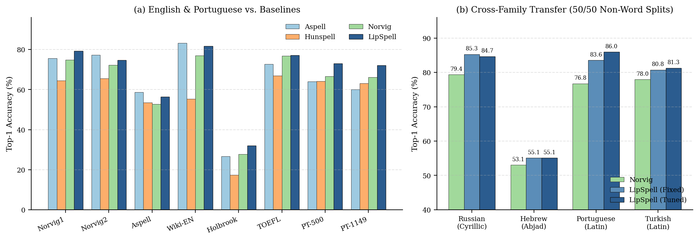

# LipSpell

**LipSpell** (**L**anguage-**I**ndependent **P**honetic **Spell**ing) is a fast, language-agnostic spell checker combining **IPA distinctive-feature phonetic edit distance**, **physical keyboard geometry**, and **corpus word-frequency priors** in a unified noisy-channel-inspired model. The name evokes both speech articulation (`[+labial]`) and the phonetic misspelling pun *lip* $\leftrightarrow$ *leap* (*"lip ov fayth"* $\rightarrow$ *"leap of faith"*), where `/ɪ/ ↔ /i/` and `/v/ ↔ /f/` differ by a single distinctive feature.

Unlike Soundex or Metaphone—which hardcode English-specific consonant rules into coarse buckets—this approach uses a **universal IPA articulatory feature matrix**, requiring only a grapheme-to-phoneme (G2P) converter, a word-frequency list, and a keyboard layout to adapt to a new language.

---

## Approach

1. **Precomputed Distinctive-Feature Phone Distances (`phoneticspell/features.py`)**
   * Maps IPA segments to 24 ternary articulatory features (`{-1, 0, +1}`).
   * Precomputes a `|P| x |P|` phone substitution matrix and insertion/deletion costs once at initialization for $O(1)$ lookup inside the dynamic-programming loop.
   * Supports `l1`, ALINE-style `salience`, and `cosine` metrics. **Cosine distance** performs best because it normalizes for feature sparsity differences between consonants and vowels.

2. **Keyboard Geometry (`phoneticspell/keyboard.py`)**
   * Precomputes normalized physical key-to-key Euclidean distances (QWERTY and Brazilian Portuguese ABNT2).

3. **Two-Stage Candidate Generation (`phoneticspell/candidates.py`)**
   * **Symmetric delete index** (SymSpell-style, orthographic edits $\le 2$).
   * **Coarse articulatory-skeleton index** collapsing phones into 7 broad classes (`V, N, L, S, P, T, K`) with 1-delete tolerance, sorted by descending word frequency.

4. **Unified Noisy-Channel Scoring (`phoneticspell/spellchecker.py`)**
   $$\text{Score}(w \mid x) = \lambda_{\text{freq}} \log P(w) - \lambda_{\text{orth}} d_{\text{orth}}(x, w) - \lambda_{\text{kb}} d_{\text{kb}}(x, w) - \lambda_{\text{phon}} d_{\text{phon}}(\phi(x), \phi(w))$$
   using unnormalized Damerau–Levenshtein distances with weights `(1.0, 4.0, 1.5, 4.0)` tuned on a disjoint 800-pair Birkbeck dev split.

---

## Results



### Key Improvements Achieved

* **Outperforms Norvig on all 7 datasets:** `+6.40%` Top-1 on Brazilian Portuguese (`73.00%` vs. `66.60%`), `+4.67%` on English Wikipedia (`81.67%` vs. `77.00%`), `+4.45%` on `norvig1`, `+4.33%` on `holbrook`, `+3.69%` on `aspell`, `+2.50%` on `norvig2`, and `+0.30%` on `TOEFL-Spell`.
* **Outperforms Hunspell on all 7 datasets:** `+8.80%` Top-1 on Portuguese (`73.00%` vs. `64.20%`, $n=500$; `72.15%` vs. `63.19%`, full $n=1{,}149$) at `2.6×` lower latency (`15.46` vs. `41.07 ms/word`), and `+2.9%` to `+26.3%` Top-1 across English benchmarks.
* **Language-agnostic advantage over Aspell:** Beats `aspell` on Portuguese `pt_BR` (`73.00%` vs. `64.00%`), L2 learner errors (`TOEFL-Spell`: `77.10%` vs. `72.80%`), `norvig1` (`79.26%` vs. `75.56%`), and `holbrook` (`32.00%` vs. `26.67%`), without any English-specific Soundex/Metaphone rules.
* **Cosine feature distance + fast indexing:** Switching from `l1`/`salience` to `cosine` over ternary distinctive-feature vectors consistently improves phonetic-only Top-1 (`+1.33` to `+2.59` percentage points), while precomputed lookup matrices and two-stage indexing keep unified scoring at `~9–15 ms/word` over `78k–240k` words.

### Brazilian Portuguese (`pt_BR`, `240,040` words from Enelvo + `Wikipédia: Lista de erros comuns`)

| System | Top-1 ($n=500$) | Top-5 ($n=500$) | Top-1 (full $n=1{,}149$) | ms/word ($n=500$) |
| :--- | ---: | ---: | ---: | ---: |
| `aspell` (`pt_BR`) | 64.00 | 76.80 | 60.14 | 16.09 |
| `hunspell` (`pt_BR`) | 64.20 | 79.00 | 63.19 | 41.07 |
| `norvig` | 66.60 | 83.00 | 66.23 | 0.36 |
| `phonetic` (alone) | 38.80 | 67.60 | — | 3.28 |
| **`unified` (`cosine`)** | **73.00** | **85.20** | **72.15** | 15.46 |

### Multilingual Extension & Per-Language Weight Tuning (6 Languages, 4 Families, 3 Scripts)

Evaluated on clean in-vocabulary non-word typos (50/50 dev/test split, comparing fixed English weights `(1.0, 4.0, 1.5, 4.0)` vs. per-language tuned weights):

| Language (Family / Script) | Test $n$ | Norvig T1 / T5 | LipSpell (Fixed) T1 / T5 | LipSpell (Tuned) T1 / T5 | Tuned $(\lambda_{\text{freq}},\lambda_{\text{orth}},\lambda_{\text{kb}},\lambda_{\text{phon}})$ |
| :--- | ---: | :---: | :---: | :---: | :---: |
| **Russian** (Slavic / Cyrillic) | 320 | 79.38 / 89.38 | **85.31 / 95.00** | 84.69 / 95.00 | `(1.0, 2.0, 4.0, 2.0)` |
| **Hebrew** (Semitic / Abjad) | 49 | 53.06 / 89.80 | **55.10** / 91.84 | **55.10 / 93.88** | `(1.0, 4.0, 4.0, 0.0)` |
| **Portuguese** (Romance / Latin) | 499 | 76.75 / 92.59 | 83.57 / 95.99 | **85.97 / 96.39** | `(1.0, 4.0, 1.0, 6.0)` |
| **Turkish** (Turkic / Latin) | 390 | 77.95 / **95.64** | 80.77 / 95.38 | **81.28 / 95.64** | `(1.0, 4.0, 4.0, 1.0)` |

### Turkish (`tr`, non-Indo-European pilot, `250,000` words from `FrequencyWords` + `TurkishWikiSpellingMistakes`, $n=1{,}000$)

| Mode | Top-1 (%) | Top-5 (%) | ms/word |
| :--- | ---: | ---: | ---: |
| `norvig` | 60.60 | 74.30 | 0.43 |
| `keyboard` | 35.70 | 59.40 | 2.33 |
| `phonetic` | 27.10 | 49.50 | 3.53 |
| **`unified` (`cosine`)** | **61.40** | **74.30** | 15.86 |

### French (`fr`, opaque orthography pilot, `200,000` words from `FrequencyWords` + French Wikipedia non-word typos, $n=118$)

| Mode | Top-1 (%) | Top-5 (%) |
| :--- | ---: | ---: |
| `norvig` | 57.63 | **85.59** |
| `keyboard` | 33.90 | 56.78 |
| `phonetic` | 21.19 | 42.37 |
| **`unified` (`cosine`)** | **59.32** | 83.90 |

### English (`78,393` words from `big.txt` + `american-english`, Top-1 % / Top-5 %)

| Dataset | `aspell` | `hunspell` | `norvig` | **`unified` (`cosine`)** |
| :--- | :---: | :---: | :---: | :---: |
| `norvig1` ($n=270$) | 75.56 / **92.59** | 64.44 / 84.07 | 74.81 / 91.11 | **79.26 / 92.59** |
| `norvig2` ($n=400$) | **77.25** / 87.00 | 65.50 / 84.00 | 72.25 / 87.50 | 74.75 / **88.75** |
| `aspell` ($n=516$) | **58.72 / 80.81** | 53.49 / 73.64 | 52.71 / 71.51 | 56.40 / 75.97 |
| `wikipedia` ($n=300$) | **83.33** / 91.00 | 55.33 / 70.00 | 77.00 / 89.33 | 81.67 / **91.33** |
| `holbrook` ($n=300$) | 26.67 / 42.33 | 17.33 / 31.67 | 27.67 / 42.00 | **32.00 / 46.33** |
| `TOEFL-Spell` ($n=1000$) | 72.80 / 90.40 | 66.90 / 86.90 | 76.80 / 90.40 | **77.10 / 91.10** |

### Phone-Distance Metric Ablation (English, Phonetic Top-1 / LipSpell Top-1 / LipSpell Top-5 %)

| Dataset | `l1` | `salience` | `cosine` |
| :--- | :---: | :---: | :---: |
| `norvig1` ($n=270$) | 38.89 / 78.15 / 91.85 | 38.15 / 77.78 / 92.22 | **41.48 / 79.26 / 92.59** |
| `norvig2` ($n=400$) | 35.25 / **75.25** / 88.25 | 33.25 / 74.50 / 88.25 | **37.75** / 74.75 / **88.75** |
| `aspell` ($n=516$) | 23.84 / 56.98 / 75.58 | 24.03 / **57.17** / 75.58 | **26.16** / 56.40 / **75.97** |
| `wikipedia` ($n=300$) | 38.67 / **81.67** / 91.33 | 38.67 / 81.33 / 91.33 | **40.33 / 81.67** / 91.33 |
| `holbrook` ($n=300$) | 11.67 / 30.33 / 45.00 | 11.67 / 31.00 / 45.33 | **13.00 / 32.00 / 46.33** |

---

## Repository Structure

* `phoneticspell/` — Core library (`features.py`, `keyboard.py`, `g2p.py`, `distance.py`, `candidates.py`, `spellchecker.py`, `data/distinctivefeatures_ipa.csv`)
* `scripts/` — `benchmark.py`, `tune_weights.py`, `ablate_metrics.py`, `compare_system_spellers.py`, `eval_toefl_spell.py`, `eval_portuguese.py`, `eval_turkish.py`, `eval_french.py`, `eval_slavic_semitic_and_tuning.py`, `paper_analyses.py`, `run_review_experiments.py`
* `tests/` — Unit tests (`test_spellchecker.py`, `test_portuguese.py`, `test_turkish.py`, `test_french.py`, `test_russian_hebrew.py`)
* `paper/main.tex` — English manuscript for Cambridge *Natural Language Processing* (`paper/main.pdf`)
* `paper/linguamatica/artigo.tex` — Portuguese manuscript for *Linguamática* (`paper/linguamatica/artigo.pdf`)

## Quick Start

```bash
pytest -v
python3 scripts/benchmark.py --wordlist /usr/share/dict/american-english --min-freq 1 --metric cosine
python3 scripts/compare_system_spellers.py
python3 scripts/eval_toefl_spell.py
python3 scripts/eval_portuguese.py --max-items 500
python3 scripts/paper_analyses.py
python3 scripts/run_review_experiments.py
```
